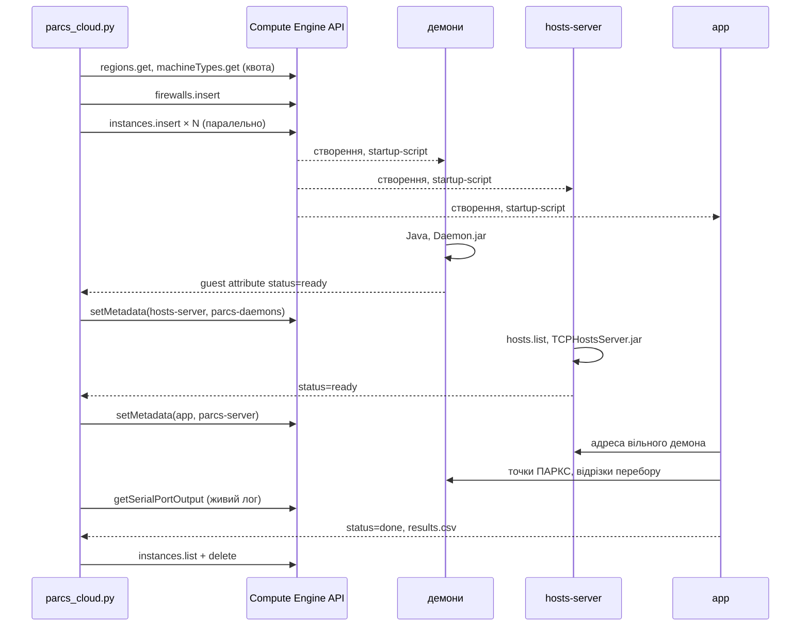

# Кластер ПАРКС через Google Compute Engine API

Завдання 2 з курсу «Хмарні обчислення»: PoC-інтеграція з хмарним API.
API: **Google Compute Engine API** (v1), клієнт — Python-бібліотека `google-cloud-compute`.

У ЛР1 ([parcs-factorization](https://github.com/yuliiayaresko/parcs-factorization)) кластер
ПАРКС для факторизації числа розгортав bash-скрипт: `gcloud` створював машини, а далі все
налаштовувалося через `ssh` — із повторами, бо свіжа машина довго не приймає з'єднання, і з
пасткою `pkill -f`, яка вбивала власну ssh-сесію.

Тут те саме робить одна Python-програма, яка звертається до Compute Engine API напряму і
**жодного разу не заходить на машини по ssh**. Машини налаштовують себе самі, а з
оркестратором спілкуються через сервер метаданих.

```
python3 parcs_cloud.py run
```

створює кластер, чекає, доки він підніметься, запускає факторизацію з ЛР1, забирає
результати й видаляє машини — також і тоді, коли щось пішло не так.

## Що таке Compute Engine API

REST API для керування віртуальними машинами Google Cloud. Усе, що робить консоль і
`gcloud compute`, — це виклики саме цього API. Основні ресурси:

| ресурс | що це | приклади методів |
|---|---|---|
| `instances` | віртуальні машини | `insert`, `get`, `list`, `delete`, `start`, `stop`, `setMetadata` |
| `machineTypes` | конфігурації CPU/RAM | `get`, `list` |
| `images` | образи дисків ОС | `getFromFamily` |
| `firewalls` | правила брандмауера VPC | `insert`, `get` |
| `regions`, `zones` | розташування, квоти | `get` |
| `zoneOperations` | довгі операції | `get`, `wait` |

Ключова особливість: усі методи, що **змінюють** ресурси, повертають не результат, а
**довгу операцію** (long-running operation). Запит `insert` відповідає за ~0,5 с, а машина
створюється у фоні ще кілька секунд. Тому можна відправити запити на всі машини одразу і
лише потім чекати операції — створення відбувається паралельно.

Автентифікація — через Application Default Credentials: у Cloud Shell вони вже є, локально
їх дає `gcloud auth application-default login`.

### Сфери застосування

- інфраструктура як код: Terraform, Pulumi, Deployment Manager працюють поверх цього API;
- автомасштабування власними правилами: створювати воркери під чергу задач і видаляти після;
- CI/CD: тимчасові тестові середовища на кожен pull request;
- наукові та пакетні обчислення: підняти кластер на час розрахунку, як у цьому проєкті;
- контроль витрат: знаходити й зупиняти машини за мітками, розкладом чи завантаженням.

## Як працює PoC



| крок | виклик API | навіщо |
|---|---|---|
| 1 | `regions.get`, `machineTypes.get` | прочитати квоту CPUS **до** створення і підібрати кількість демонів |
| 2 | `firewalls.get` / `firewalls.insert` | TCP лише між машинами з тегом `parcs` |
| 3 | `instances.insert` × N | усі машини паралельно; startup-script і параметри — у метаданих |
| 4 | `instances.getGuestAttributes` | машина сама звітує: `installing` → `waiting` → `ready` |
| 5 | `instances.get` | внутрішні IP демонів |
| 6 | `instances.setMetadata` | передати hosts-server адреси демонів, коли ті готові |
| 7 | `instances.setMetadata` | передати застосунку адресу hosts-server |
| 8 | `instances.getSerialPortOutput` | живий лог обчислень без ssh |
| 9 | `instances.getGuestAttributes` | забрати `results.csv` і лог |
| 10 | `instances.list` + `instances.delete` | видалити все з міткою `lab=parcs-api` |

### Метадані та guest attributes замість ssh

Кожна машина має локальний сервер метаданих `metadata.google.internal`. Через нього йде
зв'язок в обидва боки:

- **оркестратор → машина**: ключі метаданих (`startup-script`, `parcs-input`,
  `parcs-daemons`, `parcs-server`). Машина читає їх `curl`-ом, а коли ключа ще немає —
  чекає з `wait_for_change=true`: з'єднання висить, доки оркестратор не викличе `setMetadata`;
- **машина → оркестратор**: guest attributes. Машина пише `PUT .../guest-attributes/parcs/status`,
  оркестратор читає `getGuestAttributes`. Так передаються статус, помилка і результати.

Порядок запуску ПАРКС (спершу демони, потім hosts-server зі списком їхніх адрес, потім
застосунок) забезпечується тим, **коли** оркестратор дописує метадані. Машини створюються
одночасно і, поки встановлюють Java, нікого не чекають.

`setMetadata` замінює весь набір ключів і вимагає `fingerprint` поточної версії —
це оптимістичне блокування: якщо метадані змінилися між `get` і `setMetadata`, запит
відхиляється, а не перезаписує чужі зміни.

### Безпека й вартість

- Сервісного акаунта на машинах немає: їм не потрібно звертатися до API Google.
- Брандмауер відкриває TCP лише між машинами з тегом `parcs`, а не `0.0.0.0/0`, як
  `allow-all` у методичці. Портів 2222/3333 недостатньо: канали ПАРКС відкриваються на
  довільних портах.
- Усі машини мають мітку `lab=parcs-api`. Видалення стоїть у `finally`, тому спрацьовує і при
  помилці, і при Ctrl+C. Якщо сам оркестратор було вбито, `python3 parcs_cloud.py delete`
  знайде машини за міткою.
- Типи машин — як у ЛР1: `e2-standard-2` з виділеними ядрами для app і демонів, бо на
  burstable-машинах час міряти не можна; `e2-micro` для hosts-server.

## Структура

```
parcs_cloud.py          оркестратор: усі виклики API, команди run / list / delete
startup/common.sh       спільна частина startup-script: читання метаданих, звіти, очікування
startup/daemon.sh       демон ПАРКС
startup/hosts-server.sh hosts-server ПАРКС
startup/app.sh          застосунок: клонує ЛР1, отримує адресу, запускає make
results/                результати запуску (створюються програмою)
```

## Запуск

У [Cloud Shell](https://shell.cloud.google.com) проєкт і облікові дані вже налаштовані:

```
git clone https://github.com/yuliiayaresko/parcs-compute-api.git
cd parcs-compute-api
pip install -r requirements.txt
gcloud services enable compute.googleapis.com
python3 parcs_cloud.py run
```

Параметри:

```
python3 parcs_cloud.py run --daemons 2 --workers 1 2 4 --repeats 1   # швидкий і дешевий прогін
python3 parcs_cloud.py run --keep          # не видаляти машини після запуску
python3 parcs_cloud.py run --plan          # лише показати JSON запитів, нічого не створюючи
python3 parcs_cloud.py --zone europe-west1-b run
python3 parcs_cloud.py list                # машини з міткою lab=parcs-api
python3 parcs_cloud.py delete              # видалити їх
```

Програма пише в `results/`:

- `results.csv` — таблиця факторизації (час, прискорення, ефективність) з машини app;
- `run.log` — повний вивід застосунку ПАРКС;
- `timeline.csv` — коли кожна машина пройшла кожен етап;
- `api_calls.csv` — скільки разів викликано кожен метод API і з якою затримкою.

## Результати

Прогін у Cloud Shell, зона `europe-north1-a`: 4 демони й app на `e2-standard-2`,
hosts-server на `e2-micro`. Файли — у `results/`.

### Час розгортання

Секунди від старту оркестратора (`results/timeline.csv`):

| машина | запит insert | машину створено | ставить Java | готова |
|---|---|---|---|---|
| parcs-daemon-1 | 1,5 | 15,5 | 47,4 | 65,4 |
| parcs-daemon-2 | 2,5 | 15,7 | 41,7 | 88,0 |
| parcs-daemon-3 | 3,5 | 16,0 | 35,9 | 59,8 |
| parcs-daemon-4 | 4,6 | 16,3 | 42,1 | 93,6 |
| parcs-hosts | 5,9 | 16,5 | — | 97,9 |
| parcs-app | 6,8 | 16,8 | — | рахує з 101,2, закінчив о 326,1 |

Статуси, які машина встигла пройти, поки оркестратор її ще не опитував, у таблиці
порожні: hosts-server і app опитуються лише з того етапу, на якому їх чекають.

- **Кластер готовий за 98 с.** У ЛР1 те саме розгортання через `gcloud` і ssh тривало
  10–15 хвилин: машини налаштовувалися по черзі, а кожна ssh-команда чекала й повторювалася.
- **Усі шість машин створено майже одночасно — між 15,5 і 16,8 с**, хоча запити `insert`
  відправлялися з інтервалом близько секунди. Це і є виграш від довгих операцій: оркестратор
  не чекає, доки створиться одна машина, щоб просити наступну.
- Найдовший етап розгортання — встановлення Java з `apt-get` (20–50 с на машину). Його можна
  прибрати власним образом диска з уже встановленою Java (`images.insert`).
- Увесь цикл від першого запиту до видалення — **358 с**, з них 225 с — сама факторизація.

### Виклики API

`results/api_calls.csv` — 156 викликів за 358 с:

| метод | викликів | сер., мс | макс., мс |
|---|---|---|---|
| instances.getGuestAttributes | 87 | 259 | 642 |
| instances.getSerialPortOutput | 43 | 240 | 1503 |
| instances.get | 7 | 244 | 324 |
| instances.insert | 6 | 1068 | 1263 |
| instances.delete | 6 | 322 | 492 |
| instances.setMetadata | 2 | 391 | 392 |
| machineTypes.get | 2 | 315 | 352 |
| regions.get | 1 | 352 | 352 |
| firewalls.get | 1 | 311 | 311 |
| instances.list | 1 | 149 | 149 |

- 83 % викликів — опитування стану (`getGuestAttributes`, `getSerialPortOutput`). Це ціна
  моделі «питай, поки не готово»; у продакшені її замінюють подіями з Cloud Logging або Pub/Sub.
- `insert` — найповільніший виклик (~1 с), але це лише прийом запиту: машина створюється
  у фоні ще ~10 с, і ці секунди перекриваються між машинами.

**Що не спрацювало з першого разу.** Живий лог через `getSerialPortOutput` у першому прогоні
був порожній: метод відповідав (43 виклики), але рядків із префіксом `startup-script:`, за
яким фільтрував оркестратор, у виводі порту не було — агент гостьової ОС у поточному образі
Debian 12 не пересилає туди вивід startup-скриптів. Результати від цього не постраждали, бо
приходять окремим каналом, через guest attributes.

Виправлення: скрипт більше не покладається на агента і сам дублює свій вивід у порт
`/dev/ttyS0` з власною міткою `PARCS| ` (`startup/common.sh`), а оркестратор фільтрує
саме за нею.

### Факторизація

Та сама програма з ЛР1, вхідні дані передано через метадані:

| воркерів | час, мс | сер., мс | прискорення | ефективність | збіг |
|---|---|---|---|---|---|
| 1 (посл.) | 23 678 | 23 947 | 1,00 | 100 % | еталон |
| 1 | 23 154 | 23 864 | 1,02 | 102,26 % | так |
| 2 | 11 777 | 12 041 | 2,01 | 100,53 % | так |
| 4 | 6 067 | 6 280 | 3,90 | 97,57 % | так |
| 8 | 6 148 | 7 113 | 3,85 | 48,14 % | так |

До чотирьох воркерів числа збігаються з ЛР1 (2,06 і 4,02 там). На восьми воркерах
прискорення тут нижче, ніж у ЛР1 (5,01): вісім воркерів займають усі вісім ядер разом із
JVM демонів, і розкид між повторами стає великим — середній час на 16 % гірший за найкращий,
тоді як на 1–4 воркерах різниця 2–4 %. Тобто це той самий ефект насичення ядер, що й у ЛР1,
лише цього разу він виявився сильнішим.
